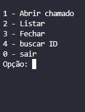
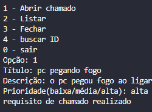
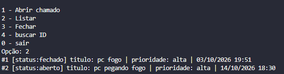
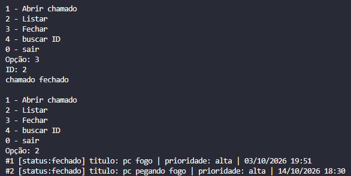
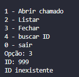

# Sistema de Chamados (Help Desk)

Programa de terminal em Python para registrar e acompanhar chamados de suporte técnico. Os dados ficam em um banco SQLite local.

Fiz este projeto para praticar POO e SQL e para entender como funciona o fluxo de um chamado: abrir, acompanhar e fechar.

## O que faz

- Abre chamado com título, descrição e prioridade (baixa, média ou alta). A data e a hora são registradas na hora da abertura.
- Lista todos os chamados.
- Busca um chamado pelo ID.
- Fecha um chamado. Ele não é apagado, só muda o status para "fechado".
- Recusa campos em branco, prioridade inválida, ID inexistente e ID que não seja número.

## Como rodar

Precisa de Python 3. Não há dependências externas.

```
git clone https://github.com/Gabriel03145/sistema-chamado
cd sistema-chamado
python main.py
```

O arquivo `chamados.db` é criado na primeira execução.

Para rodar os testes:

```
python -m unittest discover -s tests
```

## Estrutura

- `main.py`: menu e fluxo do programa
- `models.py`: classe `Chamado`
- `database.py`: criação da tabela e comandos SQL
- `tests/`: testes da classe `Chamado`

## Prints

Menu principal:



Abrindo um chamado:



Listando chamados:



Fechando um chamado:



ID inválido:



## Limitações

- Os testes cobrem só a classe `Chamado`. As funções do banco ainda não têm teste.
- Não dá para editar um chamado nem reabrir um que foi fechado.
- A listagem não filtra por status nem por prioridade.

## Próximos passos

- Testar o `database.py` com um banco em memória
- Filtrar chamados por status e prioridade
- API com FastAPI
