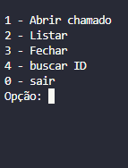
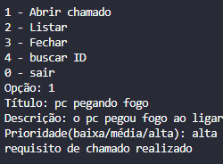
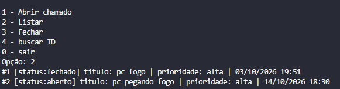
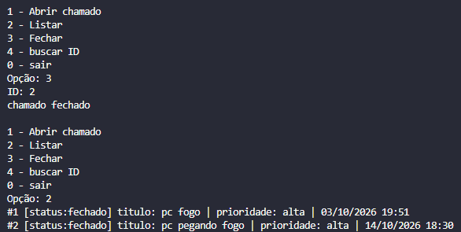
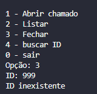

# Sistema de Chamados (Help Desk)

Sistema de chamados em terminal, feito em Python com POO e SQLite.
Simula o registro e o acompanhamento de chamados de suporte técnico.

## Tecnologias
Python 3 · SQLite · POO

## Funcionalidades
- Abrir chamado (com título, descrição e prioridade)
- Listar chamados
- Buscar chamado por ID
- Fechar chamado (o chamado não é apagado, só muda o status)
- Validação de entradas (ID inválido, chamado inexistente ou já fechado)

## Como rodar
```bash
git clone https://github.com/Gabriel03145/sistema-chamado
cd sistema-chamado
python main.py
```

## Prints
### Menu principal


### Abrindo um chamado


### Listando chamados


### Fechando um chamado


### Tratamento de erro (ID inválido)


## Estrutura
- `main.py`: menu e fluxo do programa
- `models.py`: classe `Chamado`
- `database.py`: comandos SQL

## Próximos passos
- Mais testes com pytest
- API com FastAPI